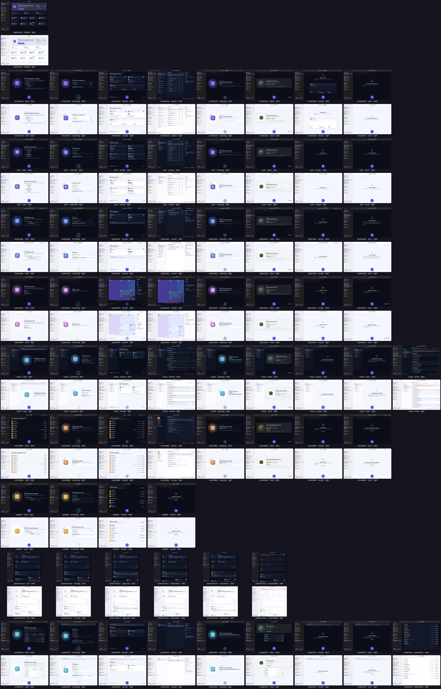

# Palette C snapshot galleries — master index (PR 16)



[`master-contact-sheet.jpg`](master-contact-sheet.jpg) (3330×5200) shows **every screen in every state of the
prototype's board matrix, dark row first, light row second** — 10 screens, 55 states, 110 captures. It was
built from the PR 16 regeneration below. Each tile is labelled `screen · state · appearance`.

All captures come from the real app on **fixture data only** (`SOSMAC_UITEST_FIXTURES=1`, the fictional
`/Users/sample` tree, "Sample Disk", example app names). The app was launched in the background
(`open -g`), only its own window was captured (`screencapture -l`), nothing was scanned, moved or trashed.
This repository is public, so no real home path, installed-app list or account name is in any image.

## Index: screen × state

Matrix = `SOS.STATES` in [`../prototype/data.js`](../prototype/data.js), the list
[`../prototype/board.html`](../prototype/board.html) renders. "Extra" states are app states the board does not
draw; they have sheets in the per-screen folder but are not in the master image.

| Screen | Board states (all captured, dark + light) | Extra states captured | Per-screen gallery (README, state sheets) |
|---|---|---|---|
| Dashboard | default | — | [pr-14](pr-14/README.md) |
| Smart Care | start · scanning · results · review · cleaning · done · empty · error | partial | [pr-7](pr-7/README.md) |
| Junk & Cache | the same eight | — | [pr-5](pr-5/README.md) |
| Duplicate Finder | the same eight (Exact copies) | the eight again in Similar images mode; Done sheets show "Sets kept" | [pr-6](pr-6/README.md) |
| Space Lens | the same eight (By Folder) | the eight again in By Type | [pr-8](pr-8/README.md) |
| Cloud Cleanup | the eight + drive | gdrive · dropbox · onedrive ("not set up in this build") | [pr-11](pr-11/README.md) |
| Uninstaller | the same eight | — | [pr-9](pr-9/README.md) |
| Updater | start · scanning · results · empty | error · checkfailed | [pr-10](pr-10/README.md) |
| Performance | live · running · approval · actiondone · actionerror · unavailable | — | [pr-12](pr-12/README.md) |
| Protection | the eight + quarantine | — | [pr-13](pr-13/README.md) |

### Capture counts and dimensions (PR 16 run)

All raw captures are 2400×1520 px (1200×760 pt at 2×); Performance 2400×2080 (1200×1040 pt). The raw files
live in the git-ignored `artifacts/ui-snapshots/`; what is committed is below. No capture is blank
(grayscale standard deviation ≥ 0.005 on every sheet).

| Gallery | Captures (dark + light) | Committed state sheets | Contact sheet |
|---|---|---|---|
| pr-5 Junk & Cache | 16 | 8 × 1840×583 | 1808×1164 |
| pr-6 Duplicate Finder | 32 | 16 × 1840×583 (8 Exact, 8 Similar) | 2 × 1808×1164 |
| pr-7 Smart Care | 18 | 9 × 1840×583 | 2260×1164 |
| pr-8 Space Lens | 32 (16 By Folder, 16 By Type) | 32 PNGs, 1200×760 (1×) | 2 × 1808×1164 |
| pr-9 Uninstaller | 16 | 8 × 1840×583 | 1808×1164 |
| pr-10 Updater | 12 | 6 × 1840×583 | 1356×1164 |
| pr-11 Cloud Cleanup | 24 | 12 × 1840×583 | 1808×1746 |
| pr-12 Performance | 12 | 6 × 1840×797 | 1356×1572 |
| pr-13 Protection | 18 | 9 × 1840×583 | 2260×1164 |
| pr-14 Dashboard | 2 | 1 × 1840×583 | 904×291 |
| **Total** | **182** | | |

A state sheet is the dark capture on the left and the light capture on the right, each scaled to 920 px wide.
Older galleries (pr-1, pr-2, pr-4a, pr-4b) are earlier before/after and component-gallery images and were not
regenerated.

### How to regenerate

```bash
# one gallery, e.g. Updater (any screen key from Scripts/ui-snapshots.sh -h)
Scripts/ui-snapshots.sh -p pr-10 -d /tmp/sosmac-pr16-dd -s updater=start,updater=scanning,updater=results,updater=checkfailed,updater=empty,updater=error
# Space Lens By Type: add -e SOSMAC_UITEST_VIEW=type;  Performance: add -w 1200x1040
# state sheet:  magick dark-X.png light-X.png -resize 920x +append -strip X-sheet.png
```

Duplicates "Similar" states are the same names with a `similar` prefix (`duplicates=similardone`); Protection's
Quarantine sub-screen is `protection=quarantine`; Cloud's not-set-up providers are `cloud=gdrive|dropbox|onedrive`.

## Comparison with the prototype board

How this was compared: each screen's states were checked against the board's state list and its section notes
(`NOTES` in `board.html`), and against the per-screen comparison already recorded in each gallery README. The
board's embedded frames are lazy iframes and did not render in the headless browser used for this pass, so no
side-by-side pixel overlay was made; the differences below are the ones documented, not an exhaustive pixel diff.

State coverage: every board state has a capture, and the board's own exclusions hold — Updater has no
review/cleaning/done (nothing is installed), Performance has no scan lifecycle, Dashboard has one state.

### Intentional differences (short list)

- **Real data or nothing.** Where the app has no backing value, the element is left out instead of filled in: no
  Dashboard health dial, no fake "last scan" figures, no current-path line when the engine reports none, no
  per-row size where the engine returns only a directory entry (Uninstaller folders read "At least …").
- **Native confirmations.** The board's *Confirmation dialogs* section is in-window; the app shows real macOS
  sheets (OD-4/CF-1), so dialogs are not part of this static matrix (covered by `ConfirmSheetTests` and manual runs).
- **Not in the app matrix:** the board's Palette A light reference, the menu-bar popover (separate MenuBarHelper
  target) and the `.tag-engine` annotations (design notes, not UI).
- **Dock wording per module (PR 16, Appendix A):** Space Lens results "Review…" / done CTA "Scan Again" with the
  card's "Back to Map" leading / empty "Choose Folder…"; Uninstaller "Review" (disabled until an app is chosen) with "Measure Again", done "Back to
  Apps"; Updater "Check Again" (no disabled Clean); Protection "Review" with no disabled Clean or Open Trash;
  Cloud API providers have no Open Trash after a server-side delete. Other modules keep the default labels.
- **Dashboard orb ring (PR 16):** the small hero orb now has the prototype's thin ring (inset 10 pt); full-size
  start orbs keep inset 34.
- **Cloud review surfaces** draw all sets expanded in one list (the prototype does too); Duplicates Similar
  mode pre-selects nothing; Duplicates Done's "Sets kept" counts sets that lost a copy.
- **Performance window is 1200×1040 pt** (the board uses 1200×760) so the banners and cards below the fold show.
- **Locale.** Decimal separators and units follow the system (the capture machine prints "11,24 GB"); the
  prototype hard-codes a dot.
- **Shared-frame quirks, not changed:** the toolbar shows the module title twice; Start bullets are centred.

Details and the remaining per-screen differences are in each gallery README under *Known differences from the prototype*.
